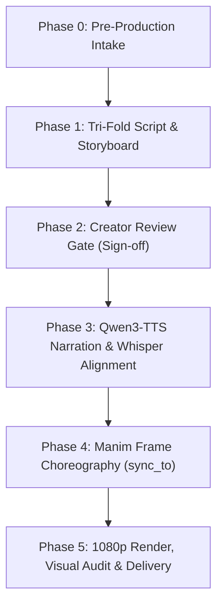

# 🎬 Manim Skill: 3Blue1Brown Explainer & Animation Engine

[](https://python.org)
[](https://www.manim.community/)
[](https://huggingface.co/Qwen/Qwen3-TTS-12Hz-0.6B-Base)
[](https://github.com/SYSTRAN/faster-whisper)
[](LICENSE)

An agentic AI skill and production framework for **Manim Community** to create high-retention mathematical, algorithmic, and system architecture explainer videos in the signature visual craft of **3Blue1Brown** (Grant Sanderson).

Featuring a **zero-shot voice cloning pipeline (Qwen3-TTS 0.6B)**, **word-accurate audio alignment (Faster-Whisper)**, a strict **anti-AI-slop design system**, and a production-grade **6-phase YouTube director protocol**.

---

## 📑 Table of Contents

- [Overview & Capabilities](#-overview--capabilities)
- [System Requirements & Installation](#-system-requirements--installation)
  - [1. System Prerequisites](#1-system-prerequisites)
  - [2. Python Environment](#2-python-environment)
  - [3. Voice Cloning Setup (Qwen3-TTS)](#3-voice-cloning-setup-qwen3-tts)
- [Integrating with AI Agents (Antigravity, Cursor, Claude)](#-integrating-with-ai-agents)
- [Production Modes](#-production-modes)
  - [Mode 1: Silent Mathematical Animation](#mode-1-silent-mathematical-animation-visual-math)
  - [Mode 2: The YouTube Explainer Pipeline (Audio + Animation)](#mode-2-the-youtube-explainer-pipeline-audio--animation)
- [Detailed Prompt Templates](#-detailed-prompt-templates)
  - [Prompt 1: Full YouTube Explainer (End-to-End)](#prompt-1-full-youtube-explainer-end-to-end)
  - [Prompt 2: Mathematical Proof / Silent Geometric Visualization](#prompt-2-mathematical-proof--silent-geometric-visualization)
  - [Prompt 3: Technical Architecture & System Walkthrough](#prompt-3-technical-architecture--system-walkthrough)
  - [Prompt 4: Pre-Production Intake Review](#prompt-4-pre-production-intake-review)
- [Anti-AI-Slop Visual Design Rules](#-anti-ai-slop-visual-design-rules)
  - [The 3Blue1Brown Palette](#the-3blue1brown-palette)
  - [Core Rules & Boundaries](#core-rules--boundaries)
- [Ecosystem & Domain Extensions](#-ecosystem--domain-extensions)
- [Repository Structure & Privacy](#-repository-structure--privacy)
- [Rendering Cheatsheet](#-rendering-cheatsheet)
- [License](#-license)

---

## 🌟 Overview & Capabilities

Traditional AI-generated animations often suffer from **AI slop**: washed-out grey canvases, text encased in meaningless rounded cards, static bullet-point slides, and disconnected audio pacing. 

This repository changes that by enforcing an elite, mathematically grounded animation workflow:

- **Pure Black Canvas (`#000000`)**: Deep contrast, vivid function curves, zero washed-out background tones.
- **Zero-Shot Voice Cloning**: Clones human voices from 3–10 second samples organized in `assets/audio-references/<voice_name>/` using **Qwen3-TTS 0.6B** (`Qwen/Qwen3-TTS-12Hz-0.6B-Base`) via `scripts/voice_clone_pipeline.py --voice <name>` on Apple Silicon (MPS), NVIDIA CUDA, or CPU.
- **Word-Level Audio Synchronization**: Millisecond-accurate word boundaries extracted via **Faster-Whisper** (`timing.json`) drive Manim transformations exactly when words are spoken.
- **Tri-Fold Storyboard Protocol**: Narrative arc structured with cold-open hooks, visual direction, spoken script, and SFX cues before a single line of code is written.
- **Mandatory User Review Gate**: Script and storyboard are presented for explicit creator sign-off before rendering.
- **Zero Dead Screen Time**: Continuous fluid transforms, dynamic updaters, and active visual metaphors.

---

## 🛠 System Requirements & Installation

### 1. System Prerequisites

Manim relies on graphics, rendering, and media utilities (`ffmpeg`, `cairo`, `pango`, `sox`, LaTeX).

#### macOS (Homebrew)
```bash
brew install ffmpeg cairo pango pkg-config sox
# Optional: Full LaTeX engine for mathematical notation
brew install --cask mactex-no-gui
```

#### Ubuntu / Debian
```bash
sudo apt-get update
sudo apt-get install -y ffmpeg sox libcairo2-dev libpango1.0-dev pkg-config texlive-full
```

#### Windows (Chocolatey / Scoop)
```powershell
choco install ffmpeg sox miktex
```

---

### 2. Python Environment

Ensure you have **Python 3.11 or newer**:

```bash
# Clone the repository
git clone https://github.com/Kasa-Harendra/manim-skill.git
cd manim-skill

# Create and activate a virtual environment
python3 -m venv .venv
source .venv/bin/activate  # On Windows: .venv\Scripts\activate

# Install core animation and synchronization dependencies
pip install --upgrade pip
pip install -r requirements.txt
```

---

### 3. Voice Cloning Setup (Qwen3-TTS & `assets/audio-references/`)

This skill features an automated voice cloning pipeline located in `scripts/voice_clone_pipeline.py`. Human voice references and accents are organized into folders within `assets/audio-references/`:

```text
assets/audio-references/
├── american/
│   ├── reference_audio.mp3       # 3–10s audio sample (.wav, .mp3, .m4a)
│   └── reference_text.txt        # Exact transcript of the sample
└── harendra/
    ├── reference_audio.m4a       # 3–10s audio sample
    └── reference_text.txt        # Exact transcript of the sample
```

To add a new voice:
1. Create a directory: `assets/audio-references/<voice_name>/`.
2. Save a clean 3–10 second voice recording as `reference_audio.wav` (or `.mp3` / `.m4a`).
3. Save the exact verbatim transcript as `reference_text.txt`.

> 🔒 **Privacy Guarantee**: All `reference_audio*` and `reference_text*` files in `assets/` are excluded by `.gitignore` so personal voice samples and transcripts are **never committed or pushed to GitHub**.

To test voice cloning from the command line:
```bash
# List available voices
python scripts/voice_clone_pipeline.py --list-voices

# Synthesize speech with a specific voice
python scripts/voice_clone_pipeline.py --voice harendra --text "Welcome to this visual walkthrough of gradient descent." --output voice/test_voice.wav
```

Or via Python:
```python
from scripts.voice_clone_pipeline import clone_voice

clone_voice(
    text="Welcome to this visual walkthrough of gradient descent.",
    output_wav_path="output/test_voice.wav",
    voice="harendra",
)
```

---

## 🤖 Integrating with AI Agents

### Antigravity IDE / Gemini CLI
Copy or symlink this folder into your global skills directory:
```bash
mkdir -p ~/.gemini/config/skills
ln -s "$(pwd)" ~/.gemini/config/skills/manim
```
Or add to your active workspace's local customizations root:
```bash
mkdir -p .agents/skills
ln -s "$(pwd)" .agents/skills/manim
```

### Claude Desktop / Cursor / GitHub Copilot
Point your agent's system instructions or rules to read [`SKILL.md`](SKILL.md) and [`design.md`](design.md) when working with Manim code or explainer videos.

---

## 🎥 Production Modes

### Mode 1: Silent Mathematical Animation (Visual Math)
*For standalone proofs, geometric visualizations, calculus transforms, and algorithm visualizers.*
- No narration audio or timing sync needed.
- Pacing is calibrated with `rate_func=smooth` and thoughtful `self.wait(...)`.
- Direct render:
  ```bash
  manim -pqh anim/scenes/calculus.py DerivativeIntuition
  ```

### Mode 2: The YouTube Explainer Pipeline (Audio + Animation)
*For educational YouTube videos, system architecture breakdowns, and masterclasses.*



1. **Pre-Production Intake**: Determine topic, duration, audience, visual priorities, and voice profile.
2. **Tri-Fold Storyboard**: Script written to `scripts/<Topic>_YouTube_Script.md` detailing Visuals, Narration, and SFX.
3. **Creator Review Gate**: Agent pauses and asks for creator confirmation before spending compute on TTS or rendering.
4. **Voice Cloning & Alignment**: Synthesizes WAVs and produces word-level `timing.json`.
5. **Choreography**: Mobjects synchronized to millisecond cues with `sync_to(cue_time)`.
6. **Render & Audit**: 1080p 30fps export with audio muxing and screenshot inspection.

---

## 💬 Detailed Prompt Templates

Copy and paste these prompts directly into your AI assistant (Antigravity, Claude, ChatGPT, Cursor):

### Prompt 1: Full YouTube Explainer (End-to-End)

```markdown
You are an Elite 3Blue1Brown-caliber Animator and Technical Director.
Using the manim skill, let's create a complete YouTube Explainer video:

Topic: How Transformer Self-Attention Actually Works (Query, Key, Value)
Target Duration: 5–7 minutes (Standard Explainer)
Target Audience: Software engineers transitioning into AI/ML
Narration Voice: Voice clone (profile: harendra)
Visual Aesthetic: Pure black canvas (#000000), dynamic vector projections, zero AI slop, no rounded boxes around math.

Please execute Phase 0 (confirm key production variables) and Phase 1 (generate the complete Tri-Fold Script and Storyboard in scripts/Transformer_Attention_Script.md).
Remember to pause at the Phase 2 Creator Review Gate before generating audio or Manim code!
```

---

### Prompt 2: Mathematical Proof / Silent Geometric Visualization

```markdown
Create a silent, elegant Manim Community scene demonstrating the Pythagorean Theorem using geometric dissection (Chou Pei Suan Ching proof).

Requirements:
1. Pure black canvas (config.background_color = BLACK).
2. Follow 3b1b aesthetic: Blue for side a, Yellow for side b, Green for hypotenuse c and area c^2.
3. Fluid continuous transformations (ReplacementTransform with rate_func=smooth).
4. No static slide headers or comments like '// Step 1'. Math formulas must breathe freely without card boxes.
5. Provide code ready to render with: manim -pqh scene.py PythagorasProof
```

---

### Prompt 3: Technical Architecture & System Walkthrough

```markdown
Generate a high-density Manim animation illustrating distributed consensus in the Raft algorithm:
- Scene 1: Leader election timeout with countdown clocks.
- Scene 2: Log replication with dynamic packet pulses flowing across network nodes.
- Scene 3: Network partition split-brain resolution.

Follow the balanced container rule from design.md:
- Use subtle RoundedRectangle containers ONLY for cluster node boundaries (stroke_width=1.5, fill_opacity=0.15).
- Keep packet data and state terms unboxed.
- Animate packet flows with animated Arrows and dynamic updaters.
```

---

### Prompt 4: Pre-Production Intake Review

```markdown
I want to make an explainer video on "Why Quaternions Avoid Gimbal Lock in 3D Rotations".
Before writing code, run the Phase 0 Pre-Production Intake:
1. Summarize the single biggest "aha!" intuition we must deliver.
2. Propose a 4-scene narrative structure with a compelling cold-open paradox.
3. Suggest the optimal visual metaphors (e.g., unit 3-sphere projection vs Euler angle rings).
```

---

## 🎨 Anti-AI-Slop Visual Design Rules

Every animation adheres strictly to the standards documented in [`design.md`](design.md):

### The 3Blue1Brown Palette

| Color Constant | Hex | Semantic Meaning |
|---|---|---|
| `BLUE` / `BLUE_C` | `#58C4DD` | Primary geometric focus, vectors, curves, $f(x)$ |
| `YELLOW` / `YELLOW_C` | `#FFFF00` | Active parameters, variables, time $t$, inputs $x$ |
| `GREEN` / `GREEN_C` | `#83C167` | Outputs, transformed states, results, areas |
| `RED` / `RED_C` | `#FC6255` | Errors, negative directions, counter-examples |
| `PURPLE` / `PURPLE_C` | `#9A72AC` | Higher dimensions, complex plane, orthogonal spaces |
| `TEAL` / `TEAL_C` | `#5CD0B3` | Coordinate grids, auxiliary constructions |
| `GOLD` | `#F0AC5F` | Fundamental constants ($\pi, e, i$), invariants |
| `WHITE` | `#FFFFFF` | LaTeX formulas, core typography |

### Core Rules & Boundaries

- ❌ **No Text Encapsulation Cards**: Never enclose formulas or definitions inside pill badges or rounded rectangle "cards". Math must float freely.
- ✅ **Permitted Component Boundaries**: Rounded rectangles are reserved exclusively for architectural boundaries (e.g., microservice nodes, hardware modules).
- ❌ **No `//` Headings or Slide Bars**: Banned corporate slides and lazy `// 01. INTRO` comment banners.
- 📐 **Safe Camera Margins**:
  - Horizontal bounds: `x ∈ [-6.4, +6.4]`
  - Vertical bounds: `y ∈ [-3.5, +3.5]`
- 🔄 **Continuous Motion**: Avoid lingering static screens; keep vectors, camera pans, and updaters active.

---

## 🧩 Ecosystem & Domain Extensions

The skill includes deep domain references and helpers for specialized fields:

| Domain | Extension / Helper | Description | Reference Guide |
|---|---|---|---|
| **Astronomy** | `manim-Astronomy` | Celestial orbits, Kepler's laws, gravitational waves | [`references/plugin_astronomy.md`](references/plugin_astronomy.md) |
| **Automata** | `manim-automata` | DFA, NFA, Turing machines, state transitions | [`references/plugin_automata.md`](references/plugin_automata.md) |
| **Brand & Tech Icons** | `manim-brand-icons` | Vector logos for AI, cloud, frameworks, databases | [`references/plugin_brand_icons.md`](references/plugin_brand_icons.md) |
| **Chemistry** | `chanim` | Molecular skeletons, reaction mechanisms | [`references/plugin_chanim.md`](references/plugin_chanim.md) |
| **Circuits & EE** | `manim-eng` | Schematic components, RLC circuits, current flows | [`references/plugin_circuits_eng.md`](references/plugin_circuits_eng.md) |
| **Data Structures** | `manim-data-structures`| Memory buffers, arrays, hash maps, binary trees | [`references/plugin_data_structures.md`](references/plugin_data_structures.md) |
| **FontAwesome** | `manim-fontawesome` | 2,000+ vector glyphs for system diagrams | [`references/plugin_fontawesome.md`](references/plugin_fontawesome.md) |
| **LLMs & AI** | `LLManim` | Attention matrices, token embeddings, Softmax | [`references/plugin_llmanim.md`](references/plugin_llmanim.md) |
| **3D Meshes** | `manim-meshes` | Polyhedra, Voronoi duals, Delaunay topology | [`references/plugin_meshes.md`](references/plugin_meshes.md) |
| **Neural Networks** | `manim-neural-network` | Layered perceptrons, forward-pass pulse flows | [`references/plugin_neural_network.md`](references/plugin_neural_network.md) |
| **Physics** | `manim-physics` | Rigid-body dynamics, optics, electromagnetism | [`references/plugin_physics.md`](references/plugin_physics.md) |
| **Progress Bars** | `manim-progress-bar` | Video scrubbers, chapter indicators | [`references/plugin_progress_bar.md`](references/plugin_progress_bar.md) |
| **LaTeX TikZ** | `manim-tikz` | Commutative diagrams and native TikZ compilation | [`references/plugin_tikz.md`](references/plugin_tikz.md) |
| **Graph Theory** | `manim-weighted-line` | NetworkX routing, weighted topologies | [`references/plugin_weighted_line.md`](references/plugin_weighted_line.md) |

---

## 📂 Repository Structure & Privacy

```text
manim-skill/
├── SKILL.md                          # Primary agent skill specification & rules
├── design.md                         # 3Blue1Brown visual design system & anti-slop guidelines
├── README.md                         # Complete framework documentation & prompts
├── requirements.txt                  # Python package dependencies
├── .gitignore                        # Git ignore rules (protects user reference voice/text)
├── assets/
│   ├── icons/                        # Vector assets, SVGs, and brand icons
│   └── audio-references/             # Voice reference samples & transcripts by speaker
│       ├── american/
│       │   ├── reference_audio.mp3   # [GITIGNORED] 3-10s voice clip
│       │   └── reference_text.txt    # [GITIGNORED] Exact transcript
│       └── harendra/
│           ├── reference_audio.m4a   # [GITIGNORED] 3-10s voice clip
│           └── reference_text.txt    # [GITIGNORED] Exact transcript
├── scripts/
│   └── voice_clone_pipeline.py       # Qwen3-TTS 0.6B voice cloning engine & CLI
├── plugins/
│   └── manim_brand_icons/            # Built-in tech & AI brand icon extension
└── references/                       # 26 in-depth guides for every domain plugin
    ├── youtube_explainer_workflow.md # The complete 6-phase YouTube masterclass protocol
    ├── voice_cloning_qwen3.md        # Qwen3-TTS 0.6B integration manual
    ├── audio_sync.md                 # Faster-Whisper alignment & timestamp locking
    ├── animations.md                 # Advanced animation patterns & updaters
    ├── example_gallery.md            # Production-tested scene recipes
    └── ...
```

---

## ⚡ Rendering Cheatsheet

Render your scenes quickly with these standard Manim CLI commands:

```bash
# Fast low-quality preview (480p 15fps) - ideal for rapid iteration
manim -pql anim/scenes/my_scene.py MyScene

# Medium quality (720p 30fps)
manim -pqm anim/scenes/my_scene.py MyScene

# Production master (1080p 60fps)
manim -pqh anim/scenes/my_scene.py MyScene

# 4K UHD Master (2160p 60fps)
manim -pqk anim/scenes/my_scene.py MyScene

# Save last frame as an image (for visual audit & thumbnails)
manim -s anim/scenes/my_scene.py MyScene
```

---

## 📄 License

This project is licensed under the [MIT License](LICENSE).
Built with passion for mathematical clarity and open-source education.
