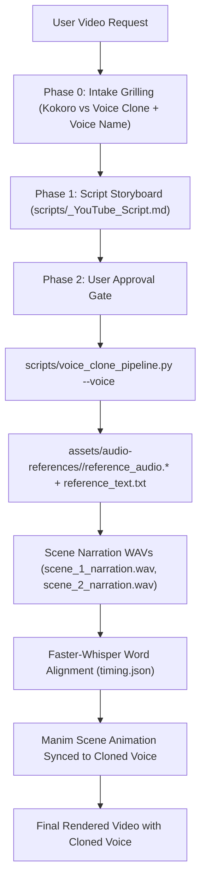

# Qwen3-TTS 0.6B Voice Cloning Integration for Manim

This guide details how **Qwen3-TTS 0.6B** is integrated into our Manim skill to automatically clone human voices and generate studio narration for all your videos using profiles organized in `assets/audio-references/`.

---

## 1. Overview & Architecture

**Qwen3-TTS-12Hz-0.6B-Base** is an advanced open-source text-to-speech model developed by the Qwen team (Alibaba Cloud):
- **Model Checkpoint**: `Qwen/Qwen3-TTS-12Hz-0.6B-Base` (~0.6B parameters, ~2.5GB weights)
- **Rapid Zero-Shot Cloning**: Clones any voice from just **3–10 seconds** of reference audio.
- **Speech Tokenizer**: `Qwen3-TTS-Tokenizer-12Hz` multi-codebook speech encoder delivering natural prosody, breathing rhythms, and expressive clarity.
- **Hardware Acceleration**: Runs on Apple Silicon (`MPS`) and NVIDIA GPUs (`CUDA`), with CPU fallback.
- **Pipeline Location**: `scripts/voice_clone_pipeline.py`.

---

## 2. Voice Profiles in `assets/audio-references/`

Each human voice or accent is organized into its own named directory within `assets/audio-references/`:

```
assets/audio-references/
├── american/
│   ├── reference_audio.mp3       # 3–10s audio sample (.wav, .mp3, .m4a supported)
│   └── reference_text.txt        # Exact transcript of the reference sample
└── harendra/
    ├── reference_audio.m4a       # 3–10s audio sample
    └── reference_text.txt        # Exact transcript of the reference sample
```

### Adding a New Voice or Accent
1. Create a directory named after the speaker or accent: `assets/audio-references/<voice_name>/`.
2. Add a clean 3–10 second voice recording (`reference_audio.wav`, `reference_audio.mp3`, or `reference_audio.m4a`).
3. Add the exact verbatim transcript as `reference_text.txt`.

> 🔒 **Privacy Guarantee**: All `reference_audio*` and `reference_text*` files in `assets/` are excluded by `.gitignore` so your personal voice samples and transcripts are **never committed or pushed to GitHub**.

---

## 3. Mandatory Pre-Production Intake Grilling

During **Phase 0 (Intake Prompting)**, the agent **MUST ALWAYS GRILL** the user on the audio engine:
1. **Narration Engine Choice**: Proceed with **Kokoro TTS** or **Qwen3-TTS Voice Clone**?
2. **If Voice Clone**: Which accent or person voice profile from `assets/audio-references/` should be used (e.g., `american`, `harendra`, or a new voice directory)?
3. **Execution**: The agent supplies the chosen voice name via the command line argument `--voice <voice_name>` when running `scripts/voice_clone_pipeline.py`.

---

## 4. Video Creation & Synthesis Pipeline



---

## 5. Command Line Interface (CLI)

The pipeline script is located at `scripts/voice_clone_pipeline.py`.

```bash
# 1. List all available voice profiles
python scripts/voice_clone_pipeline.py --list-voices

# 2. Synthesize a single sentence with a chosen voice
python scripts/voice_clone_pipeline.py --voice harendra --text "Welcome to this deep dive on backpropagation." --output voice/scene1.wav

# 3. Batch synthesize all scenes from a JSON storyboard
python scripts/voice_clone_pipeline.py --voice american --scenes scripts/scenes.json --output-dir voice/
```

### CLI Arguments
- `-v, --voice`: Name of the voice directory in `assets/audio-references/` (e.g. `harendra`, `american`).
- `-t, --text`: Text string to synthesize (or positional argument).
- `-o, --output`: Output WAV path (default: `voice/cloned_voice.wav`).
- `-s, --scenes`: Path to JSON file containing a list of scenes: `[{"id": "scene_1", "text": "..."}]`.
- `-d, --output-dir`: Output directory for multi-scene batch audio generation (default: `voice`).
- `--list-voices`: Inspect and list all detected voice profiles in `assets/audio-references/`.
- `--language`: Synthesis language (default: `English`).
- `--ref-audio`, `--ref-text`: Optional direct path overrides.

---

## 6. Python API Usage

```python
from scripts.voice_clone_pipeline import clone_voice, synthesize_video_scenes, list_available_voices

# Inspect available voices
voices = list_available_voices()
print("Available voices:", voices)  # ['american', 'harendra']

# Single line synthesis with specific voice
clone_voice(
    text="Welcome to this deep dive on backpropagation.",
    output_wav_path="output/scene1.wav",
    voice="harendra",
)

# Multi-scene video batch synthesis
scenes = [
    {"id": "scene_1", "text": "What if the formula you memorized in school was actually incomplete?"},
    {"id": "scene_2", "text": "To see why, let's look at the geometry of this coordinate curve."}
]
results = synthesize_video_scenes(
    scenes=scenes,
    output_dir="output/audio",
    voice="american",
)
```

---

## 7. Automatic Word-Level Alignment for Manim

Once `scripts/voice_clone_pipeline.py` synthesizes the voice tracks:
1. `faster-whisper` processes each scene's WAV file to generate `timing.json` with word-accurate start and end timestamps.
2. Manim animations (`Transform`, `Indicate`, `Create`) are triggered at the exact millisecond you speak the corresponding word in the cloned voice:

```python
# Synchronize animation precisely when you say the word 'tangent'
tangent_word = get_word_timestamp("timing.json", "tangent")
self.wait_until(tangent_word.start)
self.play(Create(tangent_line), run_time=tangent_word.duration)
```
