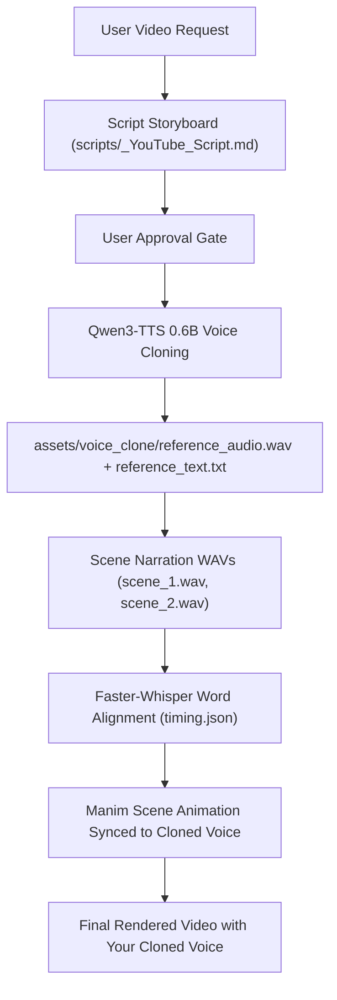

# Qwen3-TTS 0.6B Voice Cloning Integration for Manim

This guide details how **Qwen3-TTS 0.6B** is integrated into our Manim skill to automatically clone your voice and generate studio narration for all your videos.

---

## 1. Overview & Architecture

**Qwen3-TTS-12Hz-0.6B-Base** is an advanced open-source text-to-speech model developed by the Qwen team (Alibaba Cloud):
- **Model Checkpoint**: `Qwen/Qwen3-TTS-12Hz-0.6B-Base` (~0.6B parameters, ~2.5GB weights)
- **Rapid Zero-Shot Cloning**: Clones any voice from just **3–10 seconds** of reference audio.
- **Speech Tokenizer**: `Qwen3-TTS-Tokenizer-12Hz` multi-codebook speech encoder delivering natural prosody, breathing rhythms, and expressive clarity.
- **Hardware Acceleration**: Runs on Apple Silicon (`MPS`) and NVIDIA GPUs (`CUDA`), with CPU fallback.

---

## 2. Setting Up Your Cloned Voice

To enable automatic voice cloning for all your videos:

1. **Record a short voice sample** (3 to 10 seconds).
   - Speak naturally at your normal presentation pacing in a quiet room.
   - Example sentence:
     > *"Welcome back! Today we are exploring the mathematical foundations of transformer attention mechanisms and how neural networks process sequences."*
2. **Save the files in `assets/voice_clone/`**:
   - Audio file: `assets/voice_clone/reference_audio.wav`
   - Transcript: `assets/voice_clone/reference_text.txt`

---

## 3. Video Creation & Synthesis Pipeline

Whenever you request a video, the skill executes the following pipeline:



### Python API Usage
```python
from assets.voice_clone.voice_clone_pipeline import clone_voice, synthesize_video_scenes

# Single line synthesis
clone_voice(
    text="Welcome to this deep dive on backpropagation.",
    output_wav_path="output/scene1.wav"
)

# Multi-scene video batch synthesis
scenes = [
    {"id": "scene_1", "text": "What if the formula you memorized in school was actually incomplete?"},
    {"id": "scene_2", "text": "To see why, let's look at the geometry of this coordinate curve."}
]
results = synthesize_video_scenes(scenes, output_dir="output/audio")
```

---

## 4. Automatic Word-Level Alignment for Manim

Once `voice_clone_pipeline.py` synthesizes your voice:
1. `faster-whisper` processes each scene's WAV file to generate `timing.json` with word-accurate start and end timestamps.
2. Manim animations (`Transform`, `Indicate`, `Create`) are triggered at the exact millisecond you speak the corresponding word in your cloned voice:
```python
# Synchronize animation precisely when you say the word 'tangent'
tangent_word = get_word_timestamp("timing.json", "tangent")
self.wait_until(tangent_word.start)
self.play(Create(tangent_line), run_time=tangent_word.duration)
```
